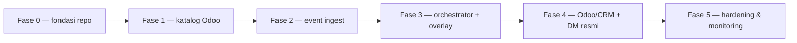

# Roadmap Toko Alkaff

Rencana bertahap untuk menjadikan repo `muhjadkaf/toko-alkaf` sebagai fondasi operasional: katalog Odoo yang terverifikasi, interaksi TikTok LIVE yang sesuai batasan platform, lalu pengamanan dan monitoring. Status awal: **fondasi dokumen dan data sudah terkumpul; belum ada implementasi layanan LIVE**.

Rencana ini merangkum poin penting dari [`docs/DOKUMENTASI-LIVE-TIKTOK-ALKAFF.md`](docs/DOKUMENTASI-LIVE-TIKTOK-ALKAFF.md), [`docs/RENCANA-PERBAIKAN-NAMLAH.md`](docs/RENCANA-PERBAIKAN-NAMLAH.md), dan [`data/katalog-alkaff-odoo/README.md`](data/katalog-alkaff-odoo/README.md). Rincian teknis tetap mengacu ke dokumen aslinya.

---

## Fase 0 — Fondasi repo

**Tujuan.** Menyiapkan repo publik yang rapi, dapat dibaca, dan tidak membocorkan rahasia, sebelum kode layanan ditambahkan.

**Deliverable.**

- `README.md`, `ROADMAP.md`, `docs/ARSITEKTUR.md`.
- Salinan dokumen sumber di `docs/` dan katalog di `data/katalog-alkaff-odoo/`, tanpa file lock `.~lock.*` dan `__pycache__`.
- Pemisahan kepemilikan direktori: `docs/` dan `data/` pada jalur ini; `odoo/` dan `services/` pada jalur terpisah.

**Kriteria selesai.**

- Semua file terbaca dan tidak ada file kosong.
- Tidak ada token/kata sandi/kredensial di repo; file lock dan bytecode tidak ikut tersalin.
- Peringatan sensitivitas `data/` tercantum di README.

**Risiko.**

- Repo publik sehingga data supplier dan harga historis bisa terekspos lebih luas.
- Tumpang tindih kepemilikan file antaragen; dokumen lama bisa mengalami drift versi/status seperti yang tercatat dalam rencana Namlah.

---

## Fase 1 — Katalog Odoo: validasi 164 produk, supplier, harga

**Tujuan.** Menjadikan CSV/XLSX katalog sebagai sumber yang valid dan aman dipakai, bukan sekadar hasil olahan nota.

**Deliverable.**

- Validasi 164 produk di sheet `IMPORT_odoo` (118 dari workbook toko + 46 produk lokal) dan reference unik dengan prefix `ALK-L-001 … ALK-L-046` untuk produk lokal.
- Pemeriksaan kategori: `Parfum`, `Parfum / Attar & Oud`, `Parfum / Gourmand`, `Parfum / Laundry`, `Parfum / Lokal Indonesia`, `Bahan Baku / Bibit Parfum`.
- Daftar 10 nama tanpa harga dari workbook yang tidak diimpor (sheet `Tanpa_Harga`), serta catatan variasi nama di sheet `Detail_Harga_Sumber`.
- Pemeriksaan 12 baris `Supplier_Lokal` dan catatan verifikasinya: status distributor/brand owner, perlu konfirmasi alamat atau kontak, harga masih dalam USD, serta email yang perlu dipastikan.

**Kriteria selesai.**

- Reference unik; tidak ada produk duplikat dari penggabungan sheet.
- `Cost Price` tidak mencampur basis gram dan kemasan; kolom `Basis Harga` menjadi acuan.
- 42 `Sales Price` yang terisi ditinjau; 122 yang kosong tetap sengaja kosong, bukan dianggap harga nol.
- `Cost Price` produk lokal tetap kosong sampai harga supplier dikonfirmasi.
- `Description` dan klaim inspired-by ditinjau admin toko sebelum dipakai sebagai klaim penjualan.

**Risiko.**

- Kontak, MOQ, stok, dan sertifikasi supplier berubah; sebagian situs tidak dapat divalidasi.
- Harga historis dari nota bukan harga jual final; salah pakai bisa menyesatkan.
- Data supplier/harga bersifat sensitif untuk repo publik.

---

## Fase 2 — Fondasi event ingest TikTok LIVE

**Tujuan.** Menerima event LIVE (komentar, gift, member, `streamEnd`) dan menormalisasinya tanpa mengambil keputusan bisnis.

**Deliverable.**

- Ingestor memakai library pihak ketiga untuk prototyping atau managed WebSocket API untuk produksi.
- Normalisasi ke envelope tunggal: `eventId`, `type`, `occurredAt`, `user`, `payload`.
- Idempotency memakai `eventId` dan filter gift streak hanya pada `repeatEnd = 1`.
- Health check koneksi dan auto-reconnect dengan backoff.

**Kriteria selesai.**

- Event `chat` dan `gift` dari akun uji terbaca dan terekam.
- Event yang sama tidak memicu dua animasi/quotation; gift berulang tidak dobel.
- Saat koneksi putus, overlay tidak menampilkan data basi.
- Ingestor tidak memanggil DM gateway dan tidak mengirim pesan otomatis.

**Risiko.**

- TikTok tidak punya API publik resmi untuk komentar/gift real-time; protokol internal dapat berubah.
- Signing service kena rate limit; komentar terlalu cepat memicu kedip overlay.
- Akun atau vendor belum tersedia untuk jalur produksi.

---

## Fase 3 — Orchestrator/state machine + overlay OBS

**Tujuan.** Mengubah event menjadi keputusan sesi dan menampilkannya sebagai scene di overlay OBS, termasuk animasi mixer dan quotation.

**Deliverable.**

- Matcher intent: alias → nama → fuzzy ringan, dengan daftar pendek maksimal 3 kandidat dan pilihan komentar `1/2/3`.
- State machine per viewer (`Idle → ProductShown → WaitingChoice → Mixing → QuoteReady → DMCaptured`) dengan satu sesi aktif per `userId` dan TTL 60 detik.
- Overlay Browser Source OBS transparan, aset lokal, serta animasi mixer bertahap (tetesan → putaran alat → botol final).
- Quotation service menghasilkan halaman HTML/PDF atau record di sistem penjualan.

**Kriteria selesai.**

- Uji matcher: 10 keyword positif dan 5 negatif sesuai runbook dokumentasi.
- Pilih `1/2/3`, timeout 60 detik, dan pindah produk di tengah sesi berperilaku sesuai dokumentasi.
- Transparansi dan resolusi overlay diuji di Browser Source; overlay sembunyi saat `streamEnd` atau heartbeat terputus.
- Quotation link dapat dibuka dari ponsel; antrean quotation dibatasi dan ada fallback "silakan DM kak".
- Tidak ada gift yang dijadikan syarat wajib untuk melihat harga.

**Risiko.**

- Salah deteksi produk membuat viewer bingung.
- Overlay letterbox/warna salah; animasi mengganggu latency.
- State sesi bocor antarviewer atau tertinggal setelah sesi selesai.

---

## Fase 4 — Integrasi Odoo/CRM & DM viewer-initiated lewat API resmi

**Tujuan.** Menyambungkan quotation ke data penjualan/Odoo dan mengirim quotation hanya lewat jalur pesan yang diizinkan platform.

**Deliverable.**

- Opsi quotation sebagai `sale.quotation` pada addon Namlah yang sudah ada; yang dikirim ke DM adalah link-nya.
- DM gateway dengan matriks jalur: keyword reply native, Business Messaging API (balasan saja) bila akun memenuhi syarat, atau TikTok Shop Customer Service API bila ada scope `seller.customer_service`.
- CTA di layar dan balasan chat LIVE mengarahkan viewer mengirim keyword `QUOTE` terlebih dahulu.
- Antrean job DM dengan audit trail; webhook DM diverifikasi tanda tangannya.

**Kriteria selesai.**

- Tidak ada DM yang dimulai dari komentar LIVE; setiap pengiriman berawal dari pesan viewer.
- Jendela balasan 48 jam / 10 pesan dan `conversation_id` dicek sebelum mengirim lewat API.
- Region pendaftaran akun dan status akses (Advanced Access / Verified Business / akun TikTok Shop) diverifikasi; bila tidak memenuhi syarat, fallback keyword reply aktif.
- Token disimpan di secret manager, bukan di kode; endpoint `/internal/*` dilindungi.
- Integrasi Odoo memakai API yang sesuai versi: perbaikan `set_param` → `set_str` pada Odoo 20 dari rencana Namlah sudah diterapkan sebelum dipakai produksi.

**Risiko.**

- Business Messaging API tidak tersedia untuk akun di EEA/Swiss/UK atau belum mendapat persetujuan/privacy review.
- Jendela balasan lewat atau scope belum ada sehingga quotation tidak terkirim.
- `direct_reply` hanya berlaku untuk komentar video, bukan DM dari live chat.
- Drift API Odoo 20 menimbulkan error runtime bila tidak diperbaiki.

---

## Fase 5 — Hardening, keamanan, monitoring

**Tujuan.** Membuat sistem aman, teramati, dan dapat dipulihkan sebelum dipakai pada akun utama.

**Deliverable.**

- Pengamanan API Odoo: pemeriksaan `Origin`/`Referer` untuk CSRF/CORS berbasis sesi, guard deny-by-default yang benar-benar memindai `/api/`, pembatasan endpoint 2FA `/code`.
- KDF PIN dengan salt per user, rate limit DB-backed, dan pencabutan `su=True`/penguatan record rule sesuai pembagian kerja rencana Namlah.
- Monitoring: health check koneksi TikTok dan overlay, log error/reconnect, serta runbook rollback (matikan overlay, matikan DM gateway, putuskan ingestor).
- Runbook deploy, backup/restore, dan verifikasi pasca-deploy; identitas viewer (`uniqueId`) dibersihkan maksimal 24 jam setelah quote selesai.

**Kriteria selesai.**

- Guard terbukti tidak vacuous dan tes yang sebelumnya merah menjadi hijau sesuai target rencana Namlah.
- Tidak ada broad `except Exception: pass`, token, atau kredensial di file yang disentuh.
- Rate limit per user aktif; webhook terverifikasi; audit trail DM tersedia.
- Rehearsal memakai akun uji dengan moderator manual sebelum go live akun utama.

**Risiko.**

- Perbaikan menyentuh modul kritis `namlah_api` yang belum punya tes, sehingga regresi sulit terdeteksi.
- Isolasi tenant bisa lemah bila hanya mengandalkan controller; `su=True` melewati record rule.
- Infrastruktur produksi, backup, dan monitoring masih menjadi keputusan yang belum diputuskan dalam dokumen perbaikan.

---

## Urutan ketergantungan

Fase 1 dan 2 dapat disiapkan paralel setelah Fase 0, tetapi go live akun utama hanya setelah Fase 5 selesai.

## Sumber rincian

- [`docs/DOKUMENTASI-LIVE-TIKTOK-ALKAFF.md`](docs/DOKUMENTASI-LIVE-TIKTOK-ALKAFF.md) — requirement, batasan platform, arsitektur, runbook go-live, risiko.
- [`docs/RENCANA-PERBAIKAN-NAMLAH.md`](docs/RENCANA-PERBAIKAN-NAMLAH.md) — baseline, prioritas P0–P2, urutan F0–F4, dan hasil uji localhost.
- [`data/katalog-alkaff-odoo/README.md`](data/katalog-alkaff-odoo/README.md) — isi sheet, field penting, dan catatan supplier.
- [`docs/ARSITEKTUR.md`](docs/ARSITEKTUR.md) — ringkasan alur data tiga layer.
