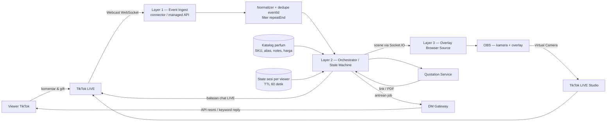
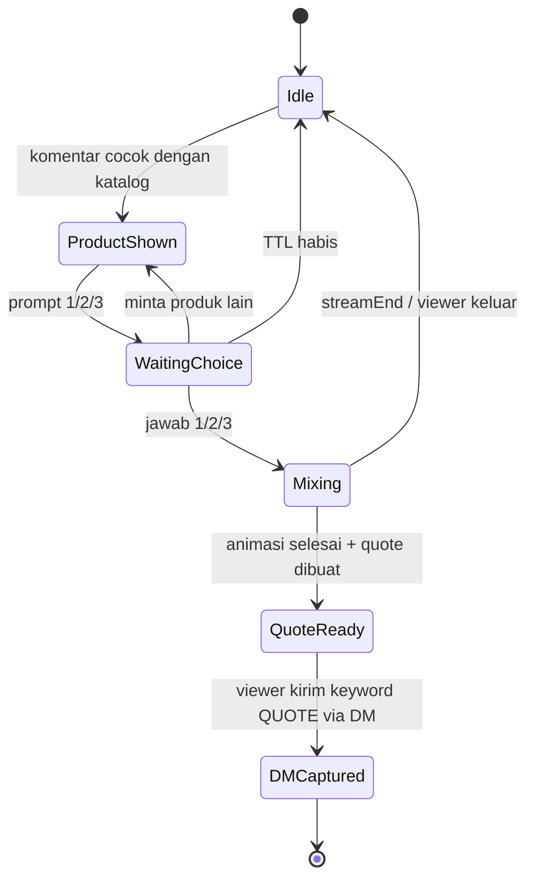
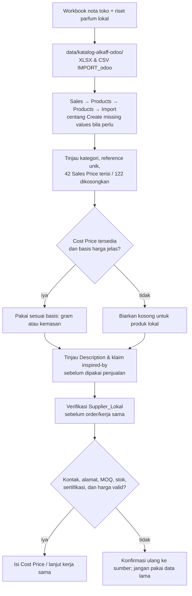

# Arsitektur Toko Alkaff — ringkasan

Dokumen ini merangkum arsitektur yang direncanakan dalam [`DOKUMENTASI-LIVE-TIKTOK-ALKAFF.md`](DOKUMENTASI-LIVE-TIKTOK-ALKAFF.md). Statusnya masih **rencana teknis; belum ada implementasi/prototipe**. Detail skema, kontrak endpoint, dan runbook ada di dokumen aslinya.

## Tiga layer

| Layer | Tanggung jawab | Batasan |
|---|---|---|
| **1. Event ingest** | Membaca komentar, gift, `member`, dan `streamEnd` dari TikTok LIVE; menormalisasi ke envelope `eventId`, `type`, `occurredAt`, `user`, `payload`; dedupe memakai `eventId` dan filter gift streak pada `repeatEnd = 1`. | Hanya membaca dan menormalisasi. Tidak boleh mengambil keputusan bisnis atau memanggil DM gateway. |
| **2. Orchestrator / state machine** | Satu-satunya pemilik state: pencocokan intent katalog, sesi per `userId` dengan TTL 60 detik, antrean scene, pembuatan quotation, dan balasan chat LIVE. | Overlay bersifat *dumb renderer*; quotation service tidak tahu soal TikTok. |
| **3. Overlay OBS (browser source)** | Merender scene `card`, `chooser`, `mixer`, `giftAlert`, dan `quoteCTA` dari event Socket.IO; transparan, aset lokal, 1920×1080. | Tidak menyimpan state bisnis; sembunyi saat `streamEnd` atau koneksi terputus. |

Lapisan pendukung: **Quotation service** menghasilkan `quoteId`/link/PDF (opsional sebagai `sale.quotation` di addon Namlah) dan **DM gateway** mengantre pengiriman lewat jalur resmi dengan audit trail. Keduanya dipanggil dari orchestrator, bukan langsung dari ingestor.

## Alur data

### Sesi viewer (ringkas)

## Batasan platform TikTok

Per 2026-11-26, seperti yang tercatat di dokumentasi asli:

- **Tidak ada API publik resmi** untuk membaca komentar/gift LIVE secara real-time. Prototipe memakai library pihak ketiga (`tiktok-live-connector` / `TikTokLive`); produksi disarankan memakai managed WebSocket API karena protokol internal sering berubah.
- **Tidak ada auto-DM dari komentar LIVE.** Business Messaging API bersifat *reply-only*: viewer harus mengirim pesan lebih dulu, dengan jendela balasan 48 jam / 10 pesan, dan dilarang memulai percakapan.
- `direct_reply` (`COMMENT_REPLY`) terbatas pada akun terdaftar di Vietnam, Indonesia, dan Thailand, serta berupa balasan ke **komentar video**, bukan DM dari live chat.
- TikTok Shop Customer Service API dapat mengirim pesan ke `conversation_id` yang sudah ada dengan scope `seller.customer_service`.
- Auto message native (welcome message, keyword reply, suggested question) berada di DM, bukan di komentar.
- Business Messaging API memerlukan app disetujui + privacy review dan akun Advanced Access / Verified Business; tidak tersedia untuk akun terdaftar di EEA/Swiss/UK.
- Tidak ada API "gambar langsung ke layar LIVE" untuk pihak ketiga; overlay masuk ke LIVE lewat OBS/TikTok LIVE Studio dan virtual camera.

**Jalur yang direkomendasikan:** komentar → overlay + balasan chat → CTA **"DM kata kunci QUOTE"** → quotation dikirim lewat DM yang sah. Harga tetap ditampilkan tanpa gift; prioritas antrean untuk gift tidak boleh menjadi syarat informasi harga.

## Alur import katalog Odoo dan verifikasi supplier

Catatan verifikasi yang tercatat di README katalog: Parfarome yang tercantum adalah **distributor Bandung**, bukan pabrik; data Ashar Grosir Parfum perlu dikonfirmasi karena situs mengembalikan HTTP 403 saat divalidasi; harga Velixir masih dalam USD dan per region; email Morris adalah email rekrutmen; Scarlett dan Saff & Co memiliki jalur reseller/partnership; Macbrame sudah terdaftar sebagai *factory* di nota toko sehingga perlu menghindari duplikasi aroma. Seluruh kontak berasal dari situs resmi/publik pada 2026-11-26 dan **bukan kontrak resmi**.

Karena repo ini publik, sheet `Supplier_Lokal` dan harga historis di `data/` perlu ditinjau sebelum disebarkan lebih luas.

## Tautan dokumentasi asli

- [`DOKUMENTASI-LIVE-TIKTOK-ALKAFF.md`](DOKUMENTASI-LIVE-TIKTOK-ALKAFF.md) — rencana teknis utama (versi 1.0, 2026-11-26); lihat terutama §3 batasan platform, §4 arsitektur, §5 detail komponen, §11 runbook go-live, dan §13 referensi.
- [`RENCANA-PERBAIKAN-NAMLAH.md`](RENCANA-PERBAIKAN-NAMLAH.md) — konteks integrasi Odoo/Namlah, urutan perbaikan, serta catatan API Odoo 20.
- [`../data/katalog-alkaff-odoo/README.md`](../data/katalog-alkaff-odoo/README.md) — isi sheet, field penting, cara import, dan catatan supplier.
- [`../ROADMAP.md`](../ROADMAP.md) — rencana Fase 0–5.

Referensi eksternal yang dicantumkan dokumen asli (dicek 2026-11-26): [TikTok-Live-Connector](https://github.com/zerodytrash/TikTok-Live-Connector), [TikTokLive](https://github.com/isaackogan/TikTokLive), [TikTok Business Messaging — Send a message](https://business-api.tiktok.com/portal/docs/send-a-message-to-a-conversation/v1.3), [Akses Business Messaging API](https://business-api.tiktok.com/portal/docs/access-to-business-messaging-api/v1.3), dan [TikTok Shop — Send Message](https://partner.tiktokshop.com/docv2/page/send-message). Ketersediaan fitur dan kebijakan dapat berubah; verifikasi ulang sebelum go live.
