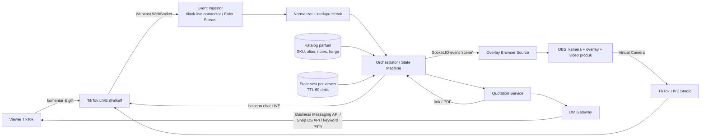
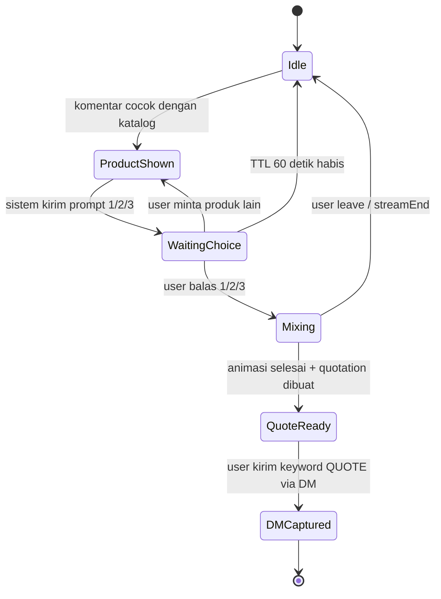
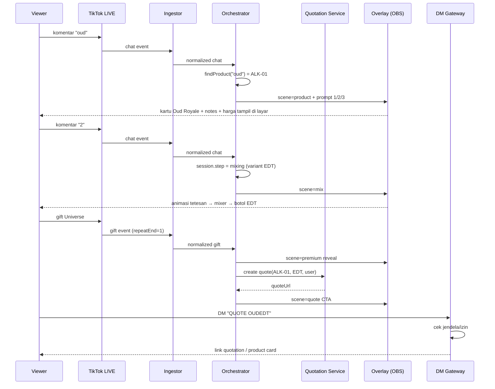

# Dokumentasi Teknis — Interactive TikTok LIVE untuk Toko Alkaff

**Versi:** 1.0  
**Tanggal:** 2026-11-26  
**Status:** Rencana teknis. Belum ada implementasi/prototype yang dibuat.  
**Objek:** Live TikTok interaktif untuk menampilkan katalog parfum virtual, menerima permintaan lewat komentar, merespons pilihan secara langsung, memicu animasi dari gift, dan mengirim quotation.

---

## 1. Ringkasan eksekutif

Konsep yang diminta dapat dibangun, tetapi **tidak bisa bergantung pada satu API TikTok**. Ada tiga domain yang berbeda:

| Domain | Sumber data | Cara keluar ke layar / user |
|---|---|---|
| Event LIVE (komentar, gift, like, join) | Webcast WebSocket internal TikTok (via library pihak ketiga / managed API) | Overlay HTML di OBS → virtual camera / stream key → TikTok LIVE |
| Interaksi pilihan produk | Komentar LIVE (`1`, `2`, `3`) atau fitur Q&A/poll LIVE yang tersedia | Balasan di chat LIVE + perubahan scene overlay |
| Quotation & DM | Business Messaging API / TikTok Shop Customer Service API / keyword reply native | Pesan DM berisi link/PDF quotation atau product card |

**Kesimpulan penting:**

- TikTok **tidak punya API publik resmi** untuk membaca komentar/gift LIVE secara real-time.
- TikTok **tidak mengizinkan auto-DM dari komentar** secara umum. Business Messaging API bersifat *reply-only*: user harus lebih dulu mengirim pesan.
- Karena itu, jalur yang direkomendasikan: **komentar → overlay + balasan chat → CTA "DM keyword QUOTE" → quotation dikirim lewat jalur DM yang sah**.
- Untuk produksi, disarankan managed WebSocket API (Euler Stream / TikTools) daripada library reverse-engineering langsung, karena TikTok sering mengubah protokol internal.

---

## 2. Requirement fungsional

| ID | Requirement | Catatan |
|---|---|---|
| F1 | Viewer mengetik nama/alias parfum di komentar | Sistem mencocokkan ke katalog (alias, typo ringan, case-insensitive) |
| F2 | Sistem menampilkan kartu produk: nama, top/heart/base notes, harga, stok, foto | Render di overlay OBS |
| F3 | Sistem menawarkan pilihan langsung dan **menunggu jawaban user** | Karena TikTok tidak punya tombol kustom generik, pakai komentar `1/2/3` (atau Q&A/poll LIVE bila tersedia untuk akun) |
| F4 | Gift memicu animasi berbeda sesuai jenis/nilai gift | Mapping tier: sparkle / mix / premium reveal |
| F5 | Animasi proses pencampuran parfum ("alat canggih") | CSS/Lottie/Rive/video alpha di overlay |
| F6 | Sesi per viewer menyimpan pilihan sementara | State machine dengan TTL |
| F7 | Quotation dibuat otomatis setelah pilihan selesai | HTML/PDF atau record di sistem penjualan |
| F8 | Quotation dikirim ke user | Lewat DM resmi (lihat §6), bukan dari event LIVE |
| F9 | Fallback saat koneksi event putus | Overlay menampilkan status "menghubungkan" dan tidak menampilkan data basi |
| F10 | Anti-spam & batas antrean | Rate limit per user, dedupe gift streak |

---

## 3. Fakta platform & batasan (per 26 Nov 2026)

| Kebutuhan | Dukungan platform | Sumber |
|---|---|---|
| Baca komentar/gift LIVE real-time | **Tidak ada API resmi publik.** Library unofficial: `tiktok-live-connector` (Node/TS), `TikTokLive` (Python). Alternatif produksi: Euler Stream / TikTools. | [TTLC](https://github.com/zerodytrash/TikTok-Live-Connector), [TikTokLive](https://github.com/isaackogan/TikTokLive) |
| Render overlay ke LIVE | Lewat TikTok LIVE Studio / OBS + virtual camera. Tidak ada API "gambar langsung ke layar LIVE" untuk pihak ketiga. | Praktik umum LIVE Studio/OBS |
| Balas komentar di chat LIVE | Library mendukung `sendMessage`, tetapi butuh sesi login + signing key; bukan DM. | [TTLC README](https://github.com/zerodytrash/TikTok-Live-Connector) |
| Kirim DM ke user dari komentar | **Tidak didukung umum.** Business Messaging API hanya balas dalam jendela 48 jam / 10 pesan setelah user mengirim pesan. Dilarang memulai percakapan. | [Send message](https://business-api.tiktok.com/portal/docs/send-a-message-to-a-conversation/v1.3), [Manage DM](https://business-api.tiktok.com/portal/docs/manage-direct-messages-for-a-business-account/v1.3) |
| Comment-to-Message | Ada sebagai `direct_reply` di Business Messaging API, **terbatas untuk akun terdaftar di Vietnam, Indonesia, Thailand**, dan berupa *reply ke komentar video* (`COMMENT_REPLY`), bukan bebas DM dari live chat. | [Send message doc](https://business-api.tiktok.com/portal/docs/send-a-message-to-a-conversation/v1.3), [direct_reply get/update](https://business-api.tiktok.com/gateway/docs/index?doc_id=1735713875563521) |
| Kirim pesan sebagai seller TikTok Shop | `POST /customer_service/202606/conversations/{conversation_id}/messages`, scope `seller.customer_service`, conversation harus sudah ada. | [TikTok Shop Send Message](https://partner.tiktokshop.com/docv2/page/send-message) |
| Akses Business Messaging API | Butuh app disetujui + data security/privacy review; akun berstatus Advanced Access atau Verified Business Account; tidak tersedia untuk akun yang terdaftar di EEA/Swiss/UK. | [Access to Business Messaging API](https://business-api.tiktok.com/portal/docs/access-to-business-messaging-api/v1.3) |
| Auto message native | Welcome message, keyword reply, suggested question, chat prompts — semuanya **di DM**, bukan komentar. | [Auto messages](https://ads.tiktok.com/resources/help/article/navigate-auto-message-business-accounts) |

> Implikasi: untuk akun Alkaff di Indonesia, opsi paling realistis adalah **keyword reply native** atau **TikTok Shop CS API**, dengan CTA "DM kata kunci QUOTE". Jika akun memenuhi syarat Business Messaging API, gunakan endpoint resmi untuk mengirim balasan/link quotation.

---

## 4. Arsitektur sistem

### 4.1 Diagram komponen



### 4.2 Prinsip pemisahan

1. **Event ingestor hanya membaca & menormalisasi.** Tidak boleh mengambil keputusan bisnis.
2. **Orchestrator satu-satunya pemilik state.** Overlay bersifat *dumb renderer*.
3. **Quotation service tidak tahu soal TikTok.** Ia hanya menerima `sku + variant + userId` dan menghasilkan dokumen/link.
4. **DM gateway tidak boleh dipanggil langsung dari ingestor.** Harus lewat antrean/job dengan audit trail.

---

## 5. Detail komponen

### 5.1 Event ingestor

Pilihan implementasi:

| Opsi | Kelebihan | Kekurangan | Rekomendasi |
|---|---|---|---|
| `tiktok-live-connector` (Node) / `TikTokLive` (Python) | Gratis, open-source, komunitas besar | Reverse-engineering; signing bergantung pihak ke-3; bisa break saat TikTok update | prototyping / internal |
| Euler Stream WebSocket API | Dikelola pihak penyedia, auto-reconnect, dukungan produksi | Berbayar, dependensi vendor | **produksi** |
| TikTools / sejenis | Event JSON rapi, 90+ tipe event, webhook | Berbayar | alternatif produksi |

Event yang perlu diproses:

| Event | Field minimum | Digunakan untuk |
|---|---|---|
| `chat` | `uniqueId`, `nickname`, `comment`, `userId` | Intent parfum, jawaban pilihan, keyword DM |
| `gift` | `uniqueId`, `gift.name`, `gift.giftId`, `repeatCount`, `repeatEnd`, `giftType`, `diamondCount` | Tier animasi |
| `member` | `uniqueId` | Sapaan/opener (opsional) |
| `like`, `share`, `follow` | count / `uniqueId` | Efek ringan (opsional) |
| `questionNew` | pertanyaan | Alternatif mekanisme pilihan bila tersedia |
| `streamEnd` | — | Cleanup state, hentikan overlay |

**Aturan gift streak:** gift dengan `giftType = 1` memicu event berulang dengan `repeatCount` naik. Proses hanya pada `repeatEnd = 1` agar animasi tidak dobel. (Dokumentasi TTLC/TikTokLive menyebut hal ini secara eksplisit.)

### 5.2 Normalisasi event (skema internal)

Semua event diubah ke envelope tunggal:

```json
{
  "eventId": "sha256(rawMessage)",
  "type": "chat | gift | member | streamEnd",
  "occurredAt": "2026-11-26T09:31:12Z",
  "user": { "id": "677...", "uniqueId": "alkaff_fan", "nickname": "..." },
  "payload": { "comment": "oud dong kak" }
}
```

`eventId` dipakai untuk **idempotency**: event yang sama tidak boleh memicu dua animasi/quotation.

### 5.3 Katalog parfum

Field minimum per produk:

| Field | Tipe | Contoh |
|---|---|---|
| `sku` | string | `ALK-01` |
| `name` | string | `Oud Royale` |
| `alias` | string[] | `["oud", "royale", "oud royal"]` |
| `topNotes` | string | `Bergamot, Saffron` |
| `heartNotes` | string | `Oud, Rose` |
| `baseNotes` | string | `Amber, Musk` |
| `variants` | object[] | `[{code:"EDP", price:289000}, {code:"EDT", price:249000}, {code:"MIST", price:159000}]` |
| `stock` | int | `24` |
| `image` | URL | `/assets/oud.png` |
| `mixerProfile` | string | `warm-amber` (menentukan warna animasi) |

**Intent matching:**
1. Lowercase + trim + buang tanda baca.
2. Cocokkan `alias` → `name` → fuzzy ringan (Levenshtein ≤ 2 untuk kata ≥ 4 karakter).
3. Jika lebih dari satu kandidat, tampilkan daftar pendek (maks. 3) dan minta user memilih `1/2/3`.

### 5.4 State machine sesi viewer



Aturan:
- Satu `userId` hanya punya satu sesi aktif.
- TTL default 60 detik; diperpanjang 15 detik setiap interaksi.
- Antrean quotation maks. 20 per menit; lebihnya masuk fallback "silakan DM kak".

### 5.5 Mapping gift → efek overlay

| Tier | Contoh gift | Efek | Dampak bisnis |
|---|---|---|---|
| `sparkle` | Rose, Finger Heart (murah) | Kilau + nama gift melayang | Apresiasi, tidak mengubah antrean |
| `mix` | gift menengah | Animation mixer berjalan + label "Mode Lab Aktif" | Membuka variant preview |
| `premium` | Universe / Lion / gift mahal | Scene "Premium Reveal", botol spotlight, prioritas antrean quotation | Viewer diprioritaskan (dengan batas adil) |

> **Catatan etika:** prioritas antrean boleh, tetapi jangan membuat pembayaran/gift terasa sebagai syarat wajib untuk mendapat informasi harga. Tetap tampilkan harga tanpa gift.

### 5.6 Overlay rendering

Pipeline:

```
scene event →Overlay Router → komponen (card | chooser | mixer | giftAlert | quoteCTA)
                          → animator (CSS keyframes / Lottie / Rive)
                          → OBS Browser Source (transparan, 1920x1080)
```

Spesifikasi teknis overlay:

- Browser Source OBS, URL `http://localhost:3000/overlay`, ukuran 1920×1080, `transparent background = true`.
- Font self-hosted; jangan bergantung Google Fonts saat internet putus.
- Aset (foto produk, Lottie JSON, video alpha) disimpan lokal.
- Animasi mixer minimal 3 tahap: **tetesan bahan → putaran alat → botol final dengan label variant**.
- Gunakan `requestAnimationFrame` / CSS transform, bukan layout-thrashing.
- Sembunyikan overlay otomatis saat `streamEnd` atau koneksi Socket.IO terputus > 5 detik.

Anggaran latency (target):

| Tahap | Target |
|---|---|
| Komentar masuk → event terekam | < 500 ms |
| Event → overlay berubah | < 300 ms |
| Jawaban `2` → animasi mulai | < 300 ms |
| Quotation link siap | < 2 s |

### 5.7 Quotation service

Input: `sku`, `variant`, `userId`, `giftTier` (opsional).  
Output: `quoteId`, `publicUrl`, opsional `pdfUrl`.

Implementasi:
- **Ringan:** halaman HTML statis `/quote/ALK-01?variant=EDT` dengan Pricing + tombol "Pesan via TikTok Shop".
- **Menengah:** PDF generated (PDFKit / WeasyPrint) berisi nama produk, notes, variant, harga, tanggal berlaku, dan kode unik.
- **Terintegrasi Odoo (opsional):** quotation dibuat sebagai `sale.quotation` di addon Namlah yang sudah ada, lalu yang dikirim ke DM adalah **link**-nya. Ini menghindari pengiriman lampiran besar dan memakai schema bisnis yang sudah ada.

Data yang ditampilkan di quotation sebaiknya:
1. Nama produk + variant.
2. Top / heart / base notes (sesuai yang ditampilkan di live).
3. Harga + promo (jika ada).
4. Estimasi pengiriman.
5. Call-to-action: "Balas QUOTE untuk pesan" / product card TikTok Shop.

### 5.8 DM gateway — matriks keputusan

| Kondisi akun | Jalur DM | Catatan |
|---|---|---|
| Akun biasa, tanpa akses API | **Keyword reply native** di Business Center | Viewer harus DM dulu dengan kata kunci persis, mis. `QUOTE` |
| Verified Business + Advanced Access + app disetujui | `POST /open_api/v1.3/business/message/send/` | Hanya balas; butuh `conversation_id` dari pesan masuk; jendela 48 jam / 10 pesan |
| Akun terdaftar di Indonesia & fitur `direct_reply` aktif | `COMMENT_REPLY` ke komentar video | Bukan DM live; cocok untuk video recap setelah live |
| Toko TikTok Shop aktif + scope `seller.customer_service` | `POST /customer_service/202606/conversations/{id}/messages` | Bisa kirim `TEXT` / `PRODUCT_CARD`; satu tipe per call |
| Tidak ada akses sama sekali | Tampilkan link di overlay + bio + reply komentar manual | Paling aman |

**CTA yang disarankan di layar:**
> "Mau quotation-nya? DM kata kunci **QUOTE OUDEDT** ke akun ini 💬"

Alasan: memulai dari pesan viewer adalah satu-satunya pola yang diterima TikTok.

---

## 6. Diagram sekuens (satu interaksi lengkap)



---

## 7. Model data minimal

| Tabel/koleksi | Field utama |
|---|---|
| `products` | sku, name, alias[], notes, variants[], stock, image, mixerProfile |
| `live_sessions` | userId, sku, step, variant, expireAt, eventIdTerakhir |
| `gift_effects` | giftName/giftId, tier, durationMs, assetKey |
| `quotes` | quoteId, sku, variant, userId, publicUrl, createdAt, status |
| `dm_jobs` | jobId, quoteId, channel, recipientRef, status, attempt, lastError |
| `event_log` | eventId, type, occurredAt, rawHash, processedAt |

Soft delete & audit: jangan hapus `event_log` saat cleanup sesi.

---

## 8. Kontrak internal (ilustratif)

| Method | Path | Fungsi |
|---|---|---|
| `GET` | `/health` | Status koneksi TikTok + overlay |
| `GET` | `/overlay` | Halaman Browser Source OBS |
| `GET` | `/quote/:sku` | Halaman quotation publik |
| `POST` | `/internal/scene` | Kirim scene ke overlay (dipakai orchestrator) |
| `POST` | `/internal/quote` | Buat quotation |
| `POST` | `/internal/dm` | Antre pengiriman DM (butuh izin) |
| `GET` | `/internal/session/:userId` | Debug state viewer |

Semua endpoint `/internal/*` harus dilindungi (token/secret), jangan diekspos publik.

---

## 9. Aspek non-fungsi

### 9.1 Keandalan
- Auto-reconnect dengan exponential backoff (1s → 30s).
- Saat reconnect, jangan replay event lama; pakai `eventId` untuk dedupe.
- Overlay masuk mode "reconnecting" bila tidak ada heartbeat 5 detik.
- `streamEnd` → clear semua sesi aktif.

### 9.2 Keamanan & privasi
- Simpan `uniqueId` hanya untuk keperluan sesi; hapus setelah quote selesai / maks. 24 jam.
- Jangan menyimpan pesan DM mentah kecuali diperlukan untuk audit.
- Webhook DM wajib diverifikasi (HMAC/tanda tangan) sebelum diproses.
- Token TikTok disimpan di secret manager, bukan di kode.
- Rate limit per user: 1 intent/5 detik, 1 quote/30 detik.
- Jangan menyimpan cookie login TikTok di server produksi kecuali mutlak diperlukan untuk `sendMessage`.

### 9.3 Kepatuhan
- Dilarang scraping/headless browser untuk mengakali pembatasan.
- Dilarang mengirim DM ke user yang belum memulai percakapan.
- hindari klaim "gratis" / "diskon" yang tidak sesuai katalog.
- Sediakan opsi "tanpa gift" untuk mendapatkan quotation.

---

## 10. Risiko & mitigasi

| Risiko | Dampak | Mitigasi |
|---|---|---|
| Protokol Webcast berubah | Event berhenti | Pakai managed API untuk produksi; pantau versi library; health check |
| Rate limit signing service | Event delay | API key berbayar / fallback vendor |
| Komentar terlalu cepat | Overlay berkedip | Debounce 300 ms + antrean scene |
| Gift streak dobel | Animasi dobel | Filter `repeatEnd` |
| DM ditolak | Quotation tidak terkirim | Cek jendela 48 jam, fallback keyword reply + link |
| Akun tidak memenuhi syarat Business Messaging | Tidak bisa DM programmatic | Pakai auto message native / TikTok Shop CS |
| Salah detected produk | Viewers bingung | Tampilkan daftar kandidat & minta konfirmasi |
| Overlay letterbox / warna salah | Tampilan jelek | Uji Browser Source di resolusi asli + transparansi |

---

## 11. Runbook go-live

### 11.1 Prasyarat
1. Akun TikTok Alkaff dalam kondisi bisa LIVE; tentukan apakah TikTok Shop terhubung.
2. Cek status akun: General / Advanced Access / Verified Business Account.
3. Cek region pendaftaran akun (berpengaruh pada DM API).
4. Siapkan katalog parfum final (SKU, alias, notes, varian, harga, stok, foto).
5. Siapkan PC/WiFi untuk OBS + koneksi event.
6. Jika mau DM otomatis: app TikTok Developer/Shop Partner dengan scope yang sesuai sudah disetujui.

### 11.2 Urutan deploy
1. Jalankan ingestor dengan akun **uji**; verifikasi event `chat` & `gift` masuk.
2. Uji matcher katalog: 10 keyword positif + 5 negatif.
3. Uji state machine: pilih `1/2/3`, timeout 60 detik, pindah produk di tengah.
4. Pasang overlay di OBS; cek transparansi & resolusi.
5. Uji gift streak dengan gift murah & mahal.
6. Uji quotation endpoint dan link-nya dibuka dari HP.
7. Uji DM: user uji mengirim keyword → balasan diterima.
8. dress rehearsal 10 menit dengan moderator manual.
9. Baru go live dengan akun utama.

### 11.3 Rollback
- Matikan overlay OBS → live tetap jalan dengan kamera host saja.
- Matikan DM gateway → tampilkan link quotation manual.
- Putuskan ingestor → hentikan auto scene; moderator ambil alih.

---

## 12. Checklist go-live

- [ ] Katalog parfum lengkap & harga valid
- [ ] Alias keyword diuji
- [ ] Rate limit aktif
- [ ] Dedupe gift streak aktif
- [ ] Overlay transparan & aset lokal tersedia
- [ ] Animasi mixer ≤ 5 detik
- [ ] Quotation link bisa dibuka di HP
- [ ] CTA DM keyword ditampilkan
- [ ] Izin DM/scope dicek (atau fallback keyword reply disiapkan)
- [ ] Moderator standby
- [ ] Akun uji dipakai untuk rehearsal
- [ ] Monitoring error & reconnect aktif

---

## 13. Referensi

- [TikTok-Live-Connector (Node.js)](https://github.com/zerodytrash/TikTok-Live-Connector)
- [TikTokLive (Python)](https://github.com/isaackogan/TikTokLive)
- [Euler Stream — WebSocket API produksi](https://www.eulerstream.com/websockets)
- [TikTok Business Messaging — Send a message](https://business-api.tiktok.com/portal/docs/send-a-message-to-a-conversation/v1.3)
- [Akses Business Messaging API](https://business-api.tiktok.com/portal/docs/access-to-business-messaging-api/v1.3)
- [Auto messages untuk akun bisnis](https://ads.tiktok.com/resources/help/article/navigate-auto-message-business-accounts)
- [TikTok Shop — Send Message](https://partner.tiktokshop.com/docv2/page/send-message)
- [TikTok Shop — Customer Engagement (pembatasan freq./eligibilitas)](https://partner.tiktokshop.com/docv2/page/customer-engagement)
- [TikTok for Developers — Webhooks overview](https://developers.tiktok.com/docs/en/webhooks-overview)

> Semua tautan diakses/dicek pada 2026-11-26. Ketersediaan fitur dan kebijakan dapat berubah; lakukan verifikasi ulang sebelum go live.

---

## 14. Lampiran — contoh payload (ilustrasi)

**Chat:**
```json
{
  "comment": "oud dong kak",
  "userId": "6776663624629974021",
  "uniqueId": "alkaff_fan",
  "nickname": "Fan Alkaff",
  "profilePictureUrl": "https://p16-sign-va.tiktokcdn.com/..."
}
```

**Gift:**
```json
{
  "uniqueId": "alkaff_fan",
  "gift": {
    "giftId": 5655,
    "name": "Universe",
    "giftType": 1,
    "repeatCount": 1,
    "repeatEnd": 1,
    "diamondCount": 34999
  }
}
```

**Contoh URL quotation:**
```
https://alkaff.example/quote/ALK-01?variant=EDP&ref=live-20261126
```

**Contoh teks balasan DM:**
```
Halo! Ini quotation parfum yang kamu minta di live tadi 👇
Oud Royale — EDP — Rp 289.000
Top: Bergamot, Saffron | Heart: Oud, Rose | Base: Amber, Musk
Link: https://alkaff.example/quote/ALK-01?variant=EDP&ref=live-20261126
Balas PESAN untuk lanjut ke checkout.
```
